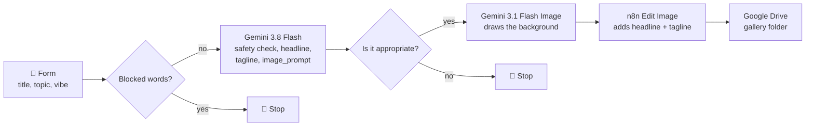

# Prompt to Poster

**Turn a talk idea into a promo card in about 30 seconds, by chaining two Gemini models with n8n on Google Cloud.**

A hands-on session for **GDG Seattle DevFest, November 7, 2026**, hosted by the Seattle n8n Ambassadors.

**👉 Course portal: [n8ndevfest2026.vercel.app](https://n8ndevfest2026.vercel.app/)**. Open it on your phone to join the workshop, make a poster, and walk through the workflow step by step.

## What it does

You fill in a short form: a talk title, a topic, and a vibe (retro, minimal, cosmic, playful, or bold). A few seconds later, a finished poster lands in a shared Google Drive folder.

The lesson is **prompt chaining**: one model writes the prompt for another. People describe a *vibe*, but image models work best with *art direction*. Gemini translates between the two.

1. **Blocked words?** checks the title and topic against a list of swear words, slurs, and political words. If one matches, the run stops before any model is called.
2. **Gemini (text)** returns structured JSON: a safety decision (`is_appropriate` and `reason`), a headline (8 words max), a tagline (15 words max), and an `image_prompt` that describes the subject, style, palette, and composition.
3. **Is it appropriate?** stops the run if Gemini rejected the idea. Gemini understands meaning, so it catches what the word list misses.
4. **Gemini (image)** turns that `image_prompt` into a 3:4 background.
5. **n8n** adds the headline and tagline itself, so the text is always spelled exactly as written and placed in the same spot.
6. **Google Drive** stores the card in the gallery folder.

Rejected ideas stop quietly: the participant still sees the form's thank-you message, but no poster is made. Each rejection shows up in n8n's **Executions** tab.

## What's in this folder

| Path | What it is |
|---|---|
| [`workflow/prompt-to-poster.json`](workflow/prompt-to-poster.json) | The n8n workflow. Import it into your own n8n. |
| [`prompts/gemini-prompt.md`](prompts/gemini-prompt.md) | The Gemini instructions and JSON schema (including the safety check), the heart of the chain |
| [`docs/setup-guide.md`](docs/setup-guide.md) | Step-by-step setup for Google Cloud and n8n, written for first-timers |
| [`docs/troubleshooting.md`](docs/troubleshooting.md) | Every error we hit while building this, and how to fix it |
| [`docs/decisions-and-findings.md`](docs/decisions-and-findings.md) | Why it's built this way, and what we learned about the models |
| [`docs/workshop-runbook.md`](docs/workshop-runbook.md) | The host's plan for the 45-minute session |
| [`docs/index.html`](docs/index.html), [`docs/tutorial.html`](docs/tutorial.html) | The course portal and the "Walk the canvas" tour, deployed to [n8ndevfest2026.vercel.app](https://n8ndevfest2026.vercel.app/) from the `docs` folder |
## Quick start

You need a Google Cloud project with billing enabled, and an n8n instance (n8n Cloud works).

1. In Google Cloud, enable the **Vertex AI API** and create a **service account** with the **Agent Platform User** role (`roles/aiplatform.user`). Download its JSON key.
2. In n8n, create a **Google Service Account API** credential from that key, with the scope `https://www.googleapis.com/auth/cloud-platform`. Also create a **Google Drive OAuth2** credential with your own Google account.
3. Import `workflow/prompt-to-poster.json`. In both Gemini nodes, change the project ID in the URL to yours. In **Save to gallery**, set your Drive folder ID.
4. Pick the right credential in the three Google nodes, then click **Execute Workflow**.
5. Open the form URL **on your phone** and submit an idea.

For the full walkthrough with checks after each step, see [docs/setup-guide.md](docs/setup-guide.md).

## Adapt it

Prompt chaining works far beyond posters. Try changing:

- **The vibes:** edit the dropdown options in the **Talk idea form** node.
- **The art direction rules:** edit the system instruction in **Gemini - write copy**.
- **The safety rules:** add words to the list in **Blocked words?**, or change the topics Gemini rejects in the system instruction.
- **The output:** product images, YouTube thumbnails, illustrated docs, event badges.

## Status

Working end to end as of **November 6, 2026** on n8n Cloud, with both safety checks. Models used: `gemini-3.8-flash` and `gemini-3.1-flash-image` on Vertex AI, `global` location. Google retires models regularly, so check [decisions-and-findings.md](docs/decisions-and-findings.md#model-findings) if a model returns "not found".
